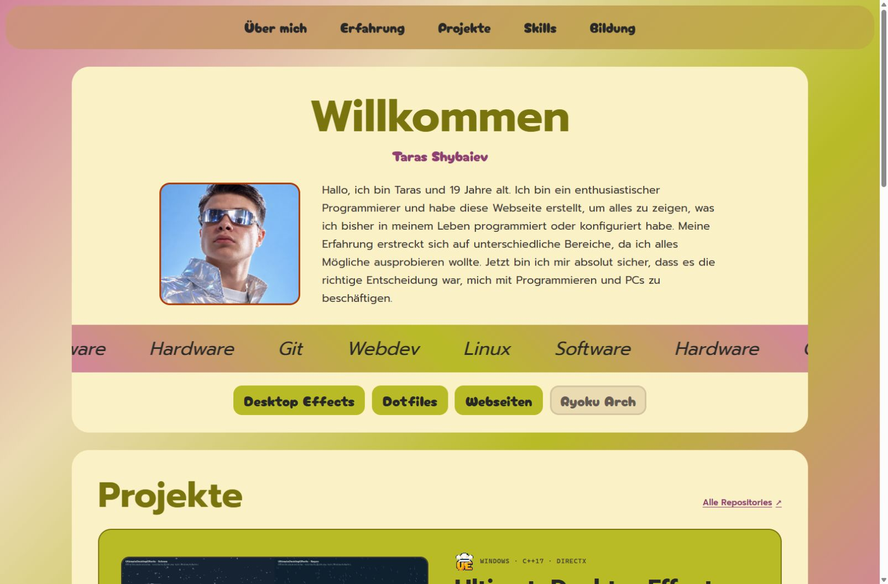
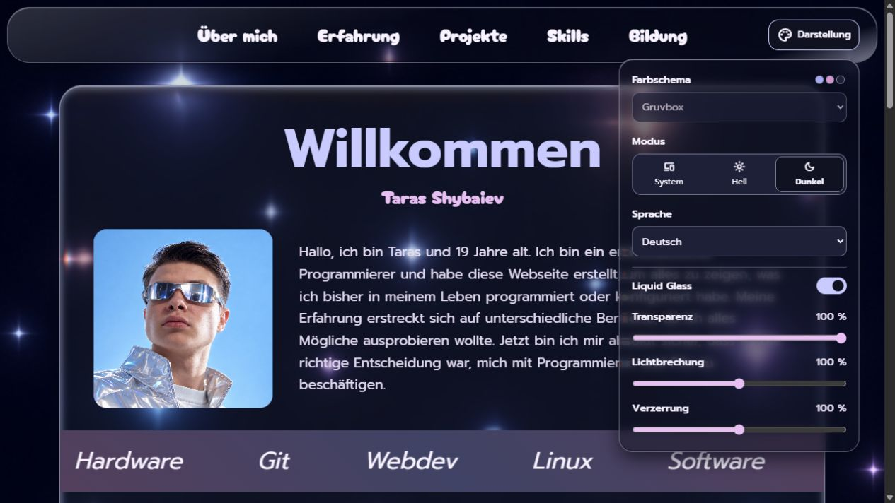
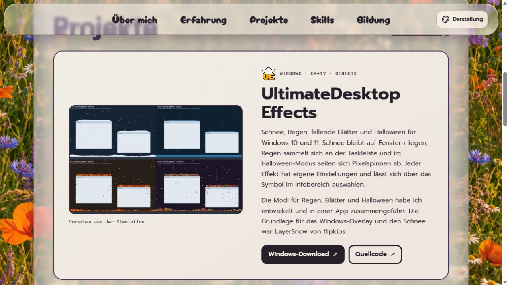
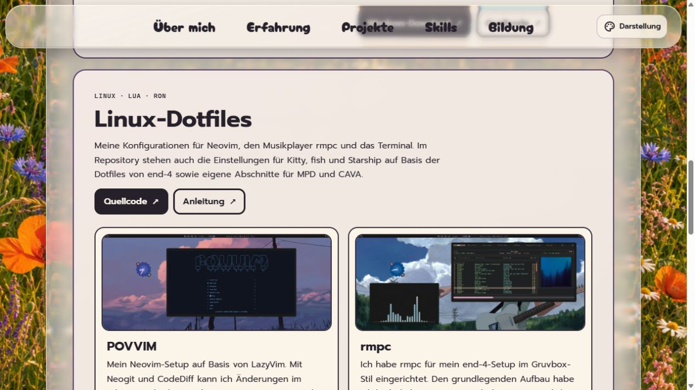

# Taras Shybaiev | Portfolio

Mein persönliches Portfolio für die Bewerbung um ein duales Studium. Hier zeige ich meine Projekte, darunter Linux-Dotfiles und Ultimate Desktop Effects.

Die Seite nutzt HTML, CSS, JavaScript und Three.js. Starte für die lokale Vorschau `python -m http.server 8000` im Projektordner und öffne `http://localhost:8000`.

## Screenshots

